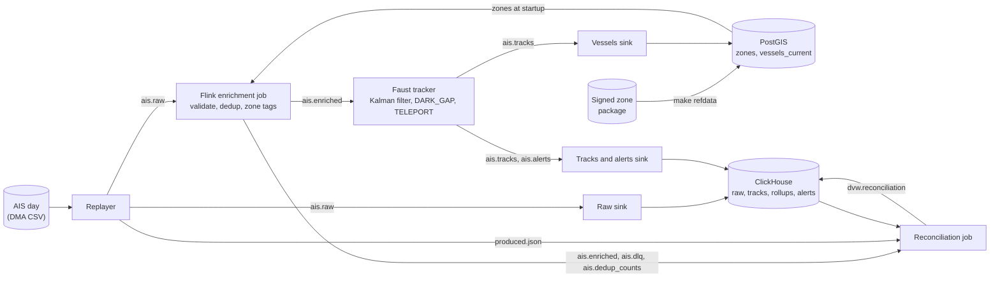

# Dark Vessel Watch

Ships report their position, speed and identity over AIS. Ships involved in illegal fishing, sanctions evasion or smuggling often hide by switching AIS off, faking their position, or sharing an identity (MMSI) with another ship. This project replays a day of real AIS traffic from Danish waters and flags vessels that go dark near EEZ boundaries and protected areas (DARK_GAP) or jump to impossible positions (TELEPORT), as it happens.

It is a streaming pipeline that runs on a laptop without a network connection: Redpanda, Flink, Faust, ClickHouse and PostGIS, all in Docker Compose. It keeps per-vessel state, raises alerts within seconds, stores the full history, and proves with a reconciliation job, per partition and per run, that no message was lost or duplicated, including when components are killed mid-run.

## Architecture



Every topic has 6 partitions. Vessel topics are keyed by MMSI; `ais.dedup_counts` is keyed by `run_id`. The Flink job is exactly-once; the tracker is at-least-once with outputs written before state, and every sink is idempotent, so a crash can repeat a message but never lose one. Details are in [docs/architecture.md](docs/architecture.md).

## Results

From one command, `make report CHAOS=1`, at commit `319c8bd` on an 8 GB Apple M1 laptop with a 3.9 GB Docker VM: 700,000 rows of the 2026-10-28 DMA day plus labelled anomalies at 10x. The Flink TaskManager, the tracker and the Flink JobManager were killed one after another partway through. Full report: [docs/results/2026-11-05-319c8bd.md](docs/results/2026-11-05-319c8bd.md); every report and the earlier hand-measured numbers are in [docs/results.md](docs/results.md).

| What | Result |
|---|---|
| Zero loss with three components killed (`make reconcile-run`) | every check OK on all 6 partitions: 701,815 produced = 701,815 stored; 413,113 enriched + 4,538 DLQ + 284,164 counted duplicates |
| Flink recovery | TaskManager failover restored checkpoint 1017; after the JobManager kill, `make flink-up` restored checkpoint 1055 of the killed job |
| Duplicates after `FINAL` | 0 in raw, tracks and alerts; 24 alerts = 24 distinct `alert_id` |
| Injected anomalies (`make score`) | DARK_GAP 3 / 0 / 0 and TELEPORT 3 / 0 / 0 (TP / FP / FN), precision and recall 1.00, 4 decoys silent |
| End-to-end latency, replay send to track stored | p99 171 s for records sent before the first fault, 166 s over the whole run, against a 5 s target: the tracker is the bottleneck |
| Throughput, one worker each | replay 1,953 records/s; Flink 5,974/s peak while catching up; tracker 575/s average, 3,054/s peak |
| Flink checkpoints | 228 completed, 13 failed, average 301 ms, max 7.6 s |
| Peak memory, everything running | 2,861 MiB of the 3.9 GiB Docker VM |

## Status and limitations

A day of Danish AIS traffic replays at 10x through validation, dedup, zone tagging, Kalman tracking and DARK_GAP and TELEPORT detection, with history in ClickHouse and current positions in PostGIS. Every run can be reconciled to zero loss per partition, including runs where the Flink TaskManager or a sink was killed partway through, and a tracker killed mid-run still raised exactly the injected alerts.

- p99 latency misses the 5 s target on long runs: 8.2 s over a 700,000-row run, cause not yet known.
- Vessels transmitting under a buoy or base-station MMSI are not tracked; the tracker classifies stations by MMSI range.
- There is no Flink high availability: a JobManager restart stops the job until `make flink-up`, which restores it from its last checkpoint after a crash, or from a savepoint taken before a planned stop.
- MMSI_CLASH is not built yet, and DARK_GAP does not yet exclude gaps at the edge of receiver coverage.
- No monitoring stack runs locally, by design: components log their counters, and the reconciliation job stores each run's verdict.

The full list is in [Known issues](docs/architecture.md#known-issues).

## Running it

Needs Docker with Compose v2, about 8 GB of free RAM, GNU make, and Python 3.12 with [uv](https://docs.astral.sh/uv/). The AIS data is not in the repository: `make fetch` downloads it and checks its SHA-256.

```sh
cp .env.example .env
make up        # git hooks, stack, topics, migrations, the sinks, tracker, Flink job
make ps        # every service healthy
make fetch     # download and verify the pinned AIS day (once, about 3 GB)
```

The Flink job needs a zone package in PostGIS, built from three datasets you download by hand ([docs/data.md](docs/data.md#manual-downloads)). Until one exists, `make up` says so and leaves the job unsubmitted.

```sh
make fetch-refdata   # verify the EEZ, WDPA and WPI files; prints where to download any that are missing
make refdata-image   # once, online: the GDAL + minisign image the build runs in
make refdata-key     # once: signing key in ~/.minisign/dvw.key (delete refdata/keys/dvw.pub first)
make refdata         # offline: build, verify and load the zone package into PostGIS
make flink-up        # submit the Flink job once a package is active
```

Replay and check a run:

```sh
make replay ARGS="--limit 10000"                # 10x by default; prints the run_id
make reconcile-run RUN=<run_id>                 # waits for the pipeline, then proves zero loss per partition
make zone-check RUN=<run_id>                    # a sample of zone tags recomputed in PostGIS
```

Labelled anomalies (needs at least about 650,000 rows; about 6 minutes at 10x):

```sh
make replay ARGS="--limit 700000 --inject ingest/replayer/anomalies.yaml"
make score RUN=<run_id> WAIT=600                # TP/FP/FN per alert type, and the zone of each DARK_GAP
make latency RUN=<run_id>                       # replayer send to track sent, and to TELEPORT stored
```

Kill a component mid-replay and reconcile again. Replay at 1x so there is time to kill it, and run the kill from a second terminal:

```sh
make replay SPEED=1 ARGS="--limit 10000"        # terminal 1: about 75 s; prints the run_id
docker kill dvw-flink-taskmanager               # terminal 2, while the replay runs
docker start dvw-flink-taskmanager              # the job restores its last checkpoint
make reconcile-run RUN=<run_id>
```

`make test` runs pytest and the Flink job's JUnit tests (in Docker, so no JDK needed). `make typecheck` runs `mypy --strict`. `make down` stops the stack and keeps the data. Every target is described in [docs/operations.md](docs/operations.md).

## Documentation

- [Architecture](docs/architecture.md): components, topics, delivery guarantees, detections, storage, known issues
- [Data](docs/data.md): sources, licences and attribution, manual downloads, the zone package
- [Operations](docs/operations.md): make targets, reconciliation, Flink, applying a new zone package
- [Results](docs/results.md): every measurement, with date and command
- [Design decisions](docs/decisions.md): one line per ADR

## Attribution

Contains AIS data from the Danish Maritime Authority. Zones are built from Marine Regions World EEZ v12 (CC BY-NC-SA 4.0), the WDPA from UNEP-WCMC and IUCN (non-commercial, no redistribution) and the World Port Index from NGA via the NASA Harvest Portal. None of this data is in the repository; full attribution is in [docs/data.md](docs/data.md#licences-and-attribution).
